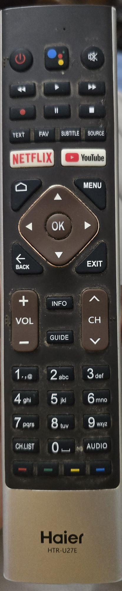

# Haier TV and remote: reference

One place for how the Haier and its remote behave, for the debloat work and the tv-quick-settings app. Facts were measured on the TV over adb on 2026-11-02 and 2026-11-03. The detailed test logs are in `tv-quick-settings/docs/haier-tests.md`, and every change made on the TV is in `changes.md` here.

## The TV

| | |
|---|---|
| Model | 55", adb reports product `hanyang`, model `haierATV`. Exact model number still unknown (Settings → About) |
| Software | Android TV 11 (not Google TV), patch 2025-11-01, build `Haier/hanyang/hanyang:11/RTO5.260324.001/15077437` |
| Chip | MediaTek/MStar m7322 (ARMv8 cores, 32-bit userland: `armeabi-v7a`), 1.3 GB RAM |
| Display | 4K panel; Android draws at **1920×1080, 320 dpi** (960×540 dp), font scale default. Video plays on a separate layer at 4K |
| Network | `adb connect <haier-ip>:5555` (IP not reserved; find it with a port-5555 scan on the TV's subnet) |
| Home screen | Projectivy Launcher (`com.spocky.projengmenu`), set as home 2026-11-02 |
| HDMI | 1 = empty, 2 = camera, 3 = PS5 or PC, 4 = JioFiber set-top box. HDMI is shown through the MediaTek Live TV app (`com.mediatek.wwtv.tvcenter`). Projectivy card images: `input-icons/` |

**Speed.** The UI thread is slow. Building about 100 views per key press took 65–190 ms here; updating views in place takes 10–20 ms. `screencap` takes 4–9 s and loads the CPU, so don't take screenshots while measuring lag. Measure frame times with `dumpsys gfxinfo <package> reset`, then `dumpsys gfxinfo <package> framestats` after the presses (the bar's window is the one with ~120 views). The GPU is the weak part: a `HorizontalScrollView`'s fading edges (an offscreen layer per frame) held scrolling to about 30 fps, and property animations (scale, translation, alpha) cost almost nothing (2026-11-03).

## The remote: Haier HTR-U27E

Bluetooth (and IR) voice remote. Input device `HaierTV-RC`, `/dev/input/event3` until 2026-11-02, `event2` on 2026-11-03 (the number can change; check `getevent -pl`). Volume Up/Down send HID usages 0x0c0080/0x0c0081 (`KEY_UNKNOWN` in the kernel). Its key layout file (`/vendor/usr/keylayout/Vendor_005d_Product_0001.kl`) can't be read over adb.

### Buttons (top to bottom)

| Row | Buttons |
|---|---|
| 1 | Power · Google Assistant · Mute |
| 2 | Rewind · Play · Fast forward |
| 3 | Record · Pause · Stop |
| 4 | TEXT · FAV · SUBTITLE · SOURCE |
| 5 | NETFLIX · YouTube |
| 6 | Home · MENU |
| 7 | D-pad Up / Left / OK / Right / Down |
| 8 | BACK · EXIT |
| 9 | VOL + / − · INFO · GUIDE · CH ∧ / ∨ |
| 10–13 | 1–9, CH.LIST, 0, AUDIO |
| 14 | Red · Green · Yellow · Blue |

### Key codes seen by Android

Logged by the app's accessibility service (keyCode, scanCode) and `getevent` (HID usage). Buttons not listed here haven't been logged yet.

| Button | Android keyCode | scanCode | HID usage | Notes |
|---|---|---|---|---|
| MENU, short | 82 `MENU` | 240 | 0x0C0071 | Does nothing by default; the app uses it for the bar |
| MENU, held 3 s | 250 `TV_INPUT_COMPONENT_2` | 240 | 0x0C00BB | Opens Settings (`com.android.tv.settings/.MainSettings`) |
| Red / Green / Yellow / Blue | 183 / 184 / 185 / 186 `PROG_RED` … `PROG_BLUE` | 240 | 0x0C003A–3D | Kernel calls all four `KEY_UNKNOWN`; Android tells them apart |
| FAV | 93 `PAGE_DOWN` | 410 | 0x0C00B9 | Kernel `KEY_SHUFFLE` |
| Up / Down / Left / Right / OK | 19 / 20 / 21 / 22 / 23 `DPAD_*` | 103 / 108 / 105 / 106 / 353 | 0x0C0042–45 / 41 | |
| Back | 4 `BACK` | 158 | 0x0C0224 | |
| Home | 3 `HOME` | 172 | 0x0C0223 | |

### How presses arrive

- **One DOWN and one UP per press, never key repeats**, even when held. A normal press lasts 140–390 ms. Hold time can only be measured as UP time minus DOWN time.
- **The remote ends every hold at about 3 s.** It sends the UP after 3.0 s and then a separate 1 ms follow-up key (scanCode 240):

  | Held for 3 s | Follow-up key | What it does by default |
  |---|---|---|
  | MENU | 250 `TV_INPUT_COMPONENT_2` | Opens Settings |
  | Red | 130 `MEDIA_RECORD` | |
  | Green | 127 `MEDIA_PAUSE` | Pauses YouTube |
  | Yellow | 86 `MEDIA_STOP` | |
  | Blue | 217 `RO` | Opens the firmware's "Magic Board" |

- **A very fast double press can arrive as one press.** On 2026-11-03, two fast Back taps and two fast MENU taps each reached the kernel as a single event (held 339 and 393 ms). Other fast pairs, 185–350 ms apart, arrived as two. Nothing on the TV, Projectivy included, can see a second tap the remote never sent.
- **Every accessibility service that filters keys sees every key**, even one another service consumed. Projectivy's service (`com.spocky.projengmenu/.services.ProjectivyAccessibilityService`, button remapping on) ran beside TV Quick Settings until 2026-11-03; it's off now (see volume holds below).
- **Volume holds and key filters.** While any accessibility service filters keys (`dumpsys input` → `InputFilterEnabled: true`), Android 11's `KeyboardInterceptor` hands Volume Up/Down straight to the system's volume handler: no service sees them and no key repeats are made, so a hold steps once. tv-quick-settings turns its filter off after each volume change until 5 s after the last one (unless its bar or sleep warning is up), so a hold within that time repeats; the first press after a pause always steps once. The filter is off only while no service asks for it. Projectivy's volume fix turns its filter off only when the volume dialog appears and back on 5 s later regardless, which cut holds or kept them from starting, so **Projectivy's accessibility service is off since 2026-11-03** (its button remapping, Back-double-press ambient mode, is lost; that dream was broken anyway). Held-volume steps land 30–250 ms apart and sometimes out of order even with no filter: that's the TV's own speed (2026-11-03).
- `adb shell input keyevent` keys don't reach accessibility services (at least on the emulator). The tv-quick-settings debug build takes keys over `am broadcast -a io.github.lettuceketchup.tvqs.DEBUG_KEY --es key <NAME>` instead. Those go to the app only, not to the app on screen.

## Picture and sound settings

All in `Settings.Global` (writing needs `WRITE_SECURE_SETTINGS`). The TV's config service (`TVSettingConfig`, in `com.mediatek.wwtv.tvcenter`) watches the keys and applies each write with `setConfigValue` (logcat tag `TVSettingConfig`). The TV's own menu (`PictureFragment`) writes the same keys, so the app and the menu take the same path.

| Key | Values | Behaviour |
|---|---|---|
| `picture_backlight` | 0–100 | Live. Stored **per picture mode and per input** (apps vs each HDMI); a write goes to the mode and input showing now. Check which input is in front before restoring a value |
| `picture_mode` | 0 User, 7 Standard, 3 Vivid, 2 Sport, 9 Movie, 10 Game, 11 Energy Saving (menu order) | Live: loads that mode's settings. About **0.4 s later** the TV writes the new mode's `picture_backlight` (and `picture_mode_dolby`) back to the keys, with a change notification. **Never write other values**: 12 and 13 overwrote User mode with 100s; 1, 4, 5, 6 and 8 are blank modes |
| `picture_color_temperature` | 0 User, 1 Cool, 2 Standard, 3 Warm | Live (`g_video__clr_temp`). The TV also writes the gains: Warm sets `picture_red_gain` 2 and `picture_blue_gain` −2, Standard sets both 0. Warm is visibly warmer (user, 2026-11-03) |
| `sound_style` | 0 User, 1 Standard, 2 Night, 3 Sports, 4 Movie, 5 Music, 6 News | Live, loads the mode's EQ. Don't write 7 or 8 |
| `hdmi_system_audio_control_enabled` | 0 TV speakers, 1 External audio system (ARC) | Sound → Speakers follows it. No ARC system to test the sound with yet |
| `power_picture_off` | 1 on, 0 off | 0 blacks the picture with sound on; any key brings it back. The TV stays `mWakefulness=Awake`. Standby keeps the 0, but the TV wakes with the picture on; writing 0 again then does nothing, so set it back to 1 when the TV turns off |
| `picture_blue_light` | any | Stored, but no visible effect |
| `sound_dialog_enhancement` | 0/1 | Passed to the firmware; no menu option, not checked by ear |
| `tv_timer_sleep_timer_entry_values` | 0 Off, 1–6 = 10–60 min, 7 = 90, 8 = 120 | Only mirrors the menu; **writing it starts no timer** |

Other picture keys (brightness, contrast, saturation, sharpness, gamma, gains) are in `tv-quick-settings/docs/haier-global-settings.txt`. The keys hold the values last written, not a full per-mode copy.

## Behaviour worth knowing

- **Standby from an app**: an accessibility service's `performGlobalAction(GLOBAL_ACTION_LOCK_SCREEN)` puts the TV to sleep like the power button; the remote wakes it normally.
- **Settings writes of an unchanged value** don't reach the TV's config service: no change notification, no `setConfigValue`.
- **Reinstalling the app** leaves its accessibility service unbound for a few seconds; re-setting `enabled_accessibility_services` rebinds it. `dumpsys accessibility` prints the bound services over two lines. The power button never reaches accessibility services; `dumpsys power` shows `mLastSleepReason` (`power_button`, or `accessibility` for the app's standby).
- **Screensaver**: Projectivy's "Ambient Mode on Back double press" starts `Somnambulator`. Android falls back to Backdrop (`com.google.android.backdrop`), which was disabled in debloat batch 1. The dream fails and the screen just flashes. Re-enabling Backdrop or picking Colors (`com.android.dreams.basic`) would fix it; that's the user's call.
- **Screenshots**: `screencap` shows HDMI input and YouTube video as black; only overlays and normal app UI appear.
- **Stock quick menu** (the Settings key) works only on HDMI/Live TV and only has picture mode.
- Haier's own HDMI menu used to open on MENU; tv-quick-settings takes MENU everywhere now.

## Working on the TV over adb

- Use `adb -s <haier-ip>:5555` (never `adb -e`, and `-s emulator-5554` for the `haier_tv` emulator).
- In Git Bash, set `MSYS_NO_PATHCONV=1` for commands with device paths (`/sdcard/...`), or Bash rewrites them into Windows paths.
- Useful logcat tags: `QuickService` (the app, with the bar state per key), `TVSettingConfig` / `TV_MtkTvConfig` (settings being applied), `PictureFragment` (the TV menu), `MTK_KL` (kernel, very noisy).
- To see what the TV menu writes, diff `settings list global | grep ^picture_` every 0.3 s while the user changes the menu (`tv-quick-settings/demo/out/tv7/diff.sh` did this, git-ignored). Toybox `diff` prints unified `+`/`-` lines.
- Ask whether the TV is free before operating it, and log every change in `changes.md`.
